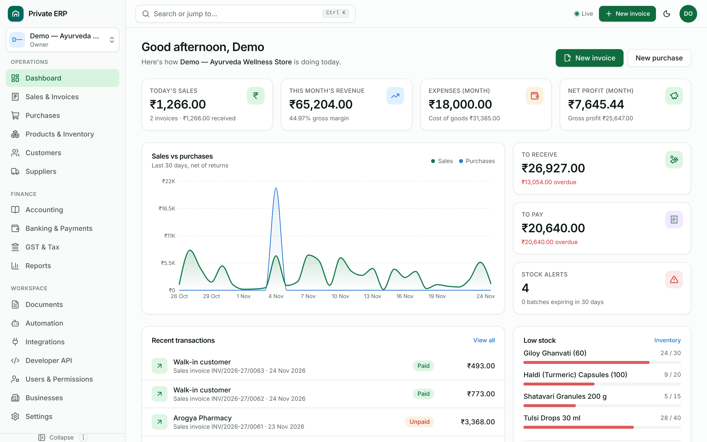
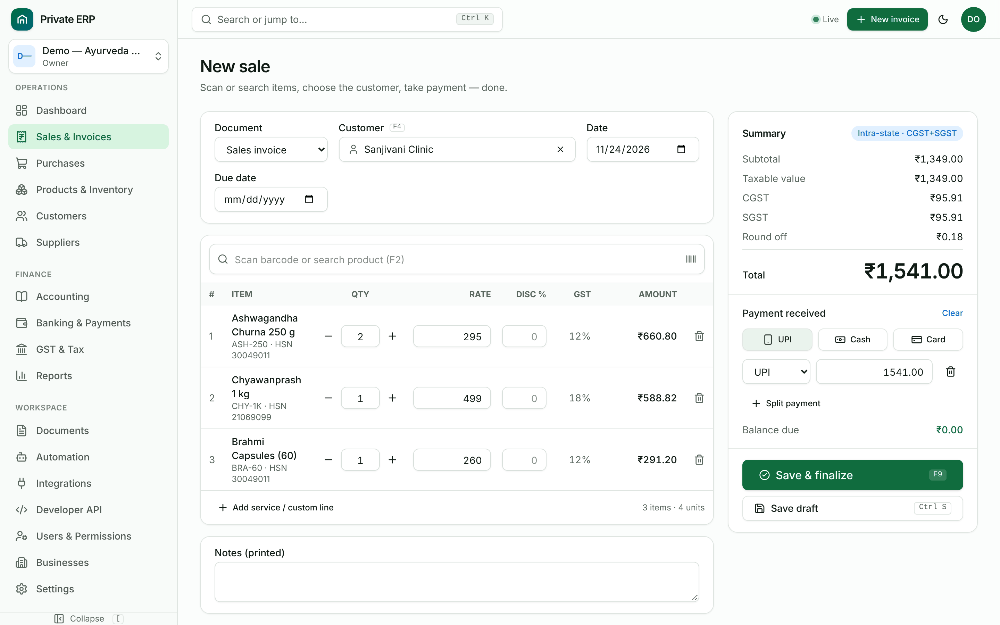
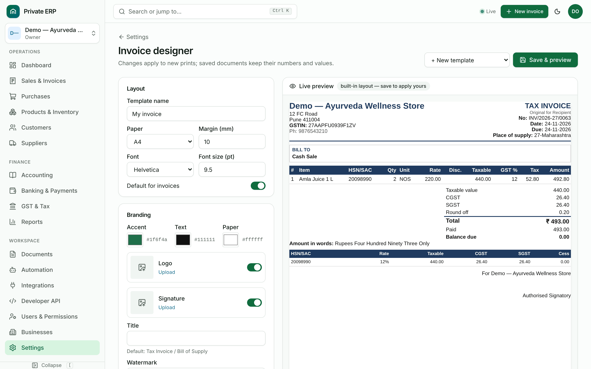
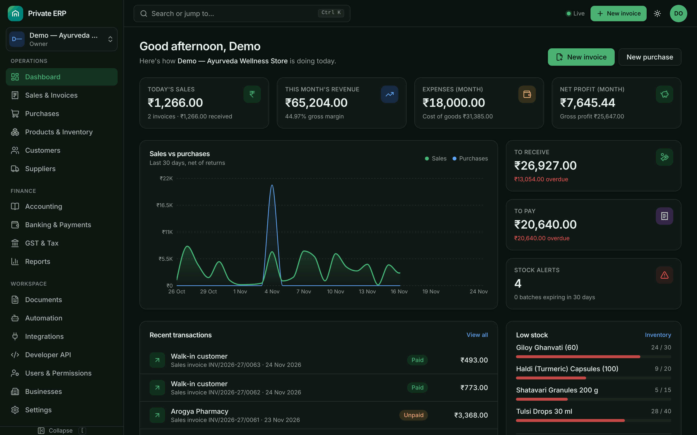
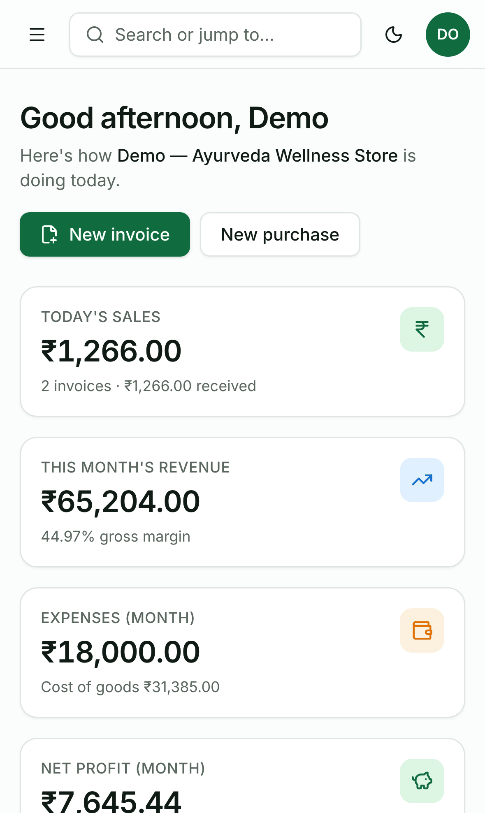

# Private ERP

A private billing, accounting, inventory and GST ERP for running several of my own businesses
from one application. One owner account; up to 30 internal users per business; each business
has its own books, branches, GST registration, financial years and numbering.

It is **not** a SaaS product: there is no public sign-up, subscriptions or tenant admin.

* [Architecture](docs/architecture.md) – service boundaries, security model, database strategy
* [Database schema](docs/database-schema.md) – tables, conventions, planned tables per phase
* [Roadmap](docs/roadmap.md) – phases and current status
* [Web app](docs/frontend.md) – frontend architecture, screens, shortcuts
* [Deployment](docs/deployment.md) – VPS setup, Docker Compose, Caddy, backups, monitoring
* [Operations](docs/operations.md) – routine tasks, health warnings, incidents, commands
* [Security](docs/security.md) and [Performance](docs/performance.md) – controls, audit findings, load-test results

## Status

* **Phase 1 backend — complete:** authentication, owner, multi-business management, branches,
  financial years, users, roles, permissions, audit trail, outbox.
* **Phase 2 backend — complete:** products, units, categories, brands, customers & suppliers,
  warehouses, and a stock engine with weighted-average/FIFO valuation, batches & expiry, serial
  numbers, opening stock, adjustments, transfers, physical counts and reversals.
* **Phase 3 backend — complete:** 11 sales & purchase document types, GST engine
  (CGST/SGST/UTGST/IGST, cess, inclusive pricing, RCM, composition, exports), versioned HSN
  rates, conversions and returns, payments and credit limits, numbering series, printable
  templates (A4–thermal, PDF, UPI QR), GSTR-1/3B preparation and e-invoice JSON.
* **Phase 4 backend — complete:** double-entry books posted automatically from every
  invoice, purchase, payment, stock movement and expense; manual journals, opening balances,
  fixed assets & depreciation, bank reconciliation, year closing; trial balance, ledgers,
  day/cash/bank book, aging, P&L, balance sheet and cash flow.
* **Phase 5 backend — complete:** integration center with encrypted credentials; e-mail
  (SMTP/Gmail), WhatsApp Cloud API, MSG91 SMS, Razorpay & Cashfree payment links with verified
  webhooks, Google Drive backups, Shopify import, CSV/Excel import & export, Tally XML export.
  See [docs/integrations.md](docs/integrations.md) for setup.
* **Phase 6 backend — complete:** API applications with scoped, hashed, rotatable keys; OAuth 2.0
  client-credentials tokens; per-app rate limits; idempotency keys; API request logs and usage;
  signed outgoing webhooks with retries, rotation and auto-disable. See [docs/api.md](docs/api.md).
* **Phase 7 — complete:** Node.js real-time service (`services/realtime`) fed by a Redis Stream
  from the transactional outbox, with permission/branch filtering, presence, resume and live
  session revocation; Redis-shared rate limits; batch PDF printing. Rust was benchmarked and not
  needed yet — see [docs/adr/0001-rust-services.md](docs/adr/0001-rust-services.md).
* **Phase 8 — complete (backend & deployment files):** TOTP two-factor sign-in with recovery
  codes, new-device and security alerts, per-IP login limits, strict security headers / HSTS,
  optional httpOnly refresh cookie with CSRF protection; custom domains verified by DNS TXT with
  Host-header checks and Caddy on-demand TLS; AES-256-GCM encrypted, verified, scheduled backups
  with GFS retention, Google Drive off-site copies and tested restores; readiness, Prometheus
  metrics and an owner health page; Docker images and Compose stack. See
  [docs/deployment.md](docs/deployment.md).
* **Phase 9 — complete:** verified SQLite → PostgreSQL migration (checksums over every row,
  books and stock re-checked before commit, dry-run rehearsal), database comparison and
  maintenance mode for the cutover. See [docs/postgres-migration.md](docs/postgres-migration.md).
* **Phase 10 — complete:** load-tested with 90 concurrent users on SQLite and PostgreSQL with
  zero errors and every integrity check passing; whole-API security audit suite; dependency and
  static security scans in CI; automated monthly restore drills; operations runbook. See
  [performance](docs/performance.md), [security](docs/security.md),
  [operations](docs/operations.md).
* **Web app — complete:** Next.js frontend for every module: dashboard, fast billing counter
  (barcode, F2/F4/F9), sales and purchases, inventory with barcode labels, customers and
  suppliers, accounting, payments, GST returns, reports, invoice designer (drag-and-drop), users and
  roles, integrations, developer API and webhooks, settings, 2FA, backups and system health. Dark
  mode, mobile layout, global search (Ctrl K), live updates. See [docs/frontend.md](docs/frontend.md).
* **Health-sector features — complete:** batches sold first-expiry-first with expired stock
  blocked, per-batch MRP, expiry alerts and one-click expiry returns to suppliers; a licence
  register (drug, FSSAI, AYUSH…) printed on invoices with renewal reminders; customer price lists,
  "10 + 1" and quantity-discount schemes, and credit hold; reorder suggestions from sales speed that
  become draft purchase orders; daily/weekly/monthly summary e-mails; an owner's page with every
  business side by side; manufacturing with recipes, true batch costing and quality-control release;
  staff attendance and salaries with commission; expense claims with bill photos and petty cash;
  e-way bill JSON for the GST portal; export of masters and vouchers to Tally; a WhatsApp
  catalogue link where buyers order from their phone; per-business modules (Settings → Modules)
  so each business shows only what it uses; for a medical store, pharmacy billing with salts and
  substitutes, rack, PTR/PTS, strip + loose selling, doctors, prescriptions required for
  Schedule H/H1/X, the H1 register, doctor-wise sales and an automatic near-expiry discount. Every page has an ⓘ guide, and Help & guide
  explains each workflow step by step. See [docs/roadmap.md](docs/roadmap.md).
* **Document library and automation — complete:** a versioned file library with folders, tags,
  trash and permission-aware attachments on invoices, parties and products; your own
  "when this happens, do that" rules (overdue reminders, big-sale alerts, low-stock e-mails,
  welcome e-mails) run by the worker, with a run history. See [docs/roadmap.md](docs/roadmap.md).

After upgrading a database that already has invoices or stock from earlier phases, run
`python -m app.cli accounting-backfill` once to post their journals.

## Run it on your computer



You need **Python 3.12+** ([python.org](https://www.python.org/downloads/) — on Windows tick
"Add python.exe to PATH") and **Node.js 22 LTS** ([nodejs.org](https://nodejs.org/)).

**Windows**

1. Double-click **`setup.bat`** (first time, and again after every update). It installs
   everything, creates `backend\.env` with new secret keys, sets up the database, asks for your
   e-mail, name and password (hidden), and offers a sample *Demo* business to explore.
2. Double-click **`start.bat`** — the ERP opens at <http://localhost:3000>.
3. **`stop.bat`** stops it; **`backup.bat`** takes an encrypted backup now.

**macOS / Linux:** `./setup.sh` once, then `./start.sh` (Ctrl+C stops it).

Your data lives in `backend/data` and your keys in `backend/.env` — back up both (the backup
key is needed to restore backups). PDFs use Microsoft Edge or Google Chrome automatically. The
web app listens only on this computer; to use it from other counters on the shop network run
`npm run start:lan` in `frontend` instead (and prefer a proper server deployment —
[docs/deployment.md](docs/deployment.md) — for daily multi-user use). Live updates appear when
Redis is available (`ERP_REDIS_URL` in `backend/.env`); everything else works without it.

| | |
|---|---|
|  |  |
|  |  |

## Running the backend by hand (development)

Requires Python 3.12+.

```bash
cd backend
python -m venv .venv && source .venv/bin/activate
pip install -e ".[dev]"            # add ,postgres for PostgreSQL support

cp .env.example .env
# put a long random value in ERP_SECRET_KEY:
python -c "import secrets; print(secrets.token_urlsafe(64))"

python -m app.cli migrate          # create / upgrade the database (SQLite: backend/data/erp.db)
python -m app.cli create-owner --email you@example.com --name "Your Name"   # prompts for password
uvicorn app.asgi:app --reload      # API docs: http://localhost:8000/api/v1/docs
```

Operations:

```bash
python -m app.cli db-check         # SQLite integrity + foreign-key check
python -m app.cli db-backup        # online, verified backup into backend/backups/
```

## Tests

```bash
cd backend
pytest                                                    # SQLite
ERP_TEST_DATABASE_URL=postgresql+psycopg://user:pw@localhost/erp_test pytest   # PostgreSQL
```

The schema in tests is built from the Alembic migrations, and a test fails if the models and
migrations drift apart. CI runs the suite on both databases.

## Typical first steps through the API

1. `POST /api/v1/auth/login` → access + refresh token.
2. `POST /api/v1/businesses` → creates the business with a head office, current financial year
   and the built-in roles.
3. `GET /api/v1/businesses/{id}/roles`, then `POST /api/v1/businesses/{id}/members` with an
   e-mail and role → returns a one-time `invite_token` to give to that person.
4. They call `POST /api/v1/auth/accept-invite` with the token and their chosen password.
