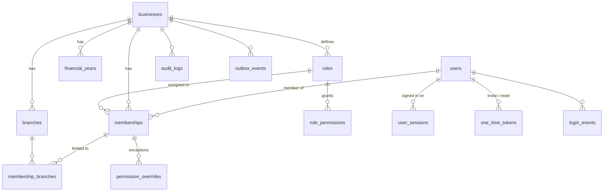

# Database schema

Source of truth: `backend/app/modules/*/models.py` and `backend/alembic/versions/`.
This document describes Phase 1 tables and the conventions every later table follows.

## Conventions

| Rule | Why |
|---|---|
| `id UUID` primary key on every entity table | Merge-safe, non-guessable, identical across SQLite/PostgreSQL migration |
| `business_id` on every business-owned row, indexed | Hard isolation boundary between businesses |
| `created_at` / `updated_at` as `UTCDateTime` | Unambiguous times; SQLite has no time zones |
| Money: `Money()` = exact decimal (18,4); quantities: `Quantity()` (18,3) | No floating-point money, ever |
| Enums: VARCHAR + CHECK (`str_enum`) | Portable; no PostgreSQL ENUM migrations |
| `ON DELETE RESTRICT` towards businesses | Business data is archived, never cascaded away |
| Posted financial documents are never updated or deleted (Phase 3+) | Corrections happen through reversal/cancellation documents |

## Phase 1 entity diagram

## Tables

### `users`
One row per person. `email` is stored lower-case and unique. `is_owner` is `TRUE` for the owner
and `NULL` for everyone else; a unique constraint plus `CHECK (is_owner IS NULL OR is_owner)`
guarantees **at most one owner** at the database level. `status`: `invited | active | suspended`.
`failed_login_count` / `locked_until` implement lockout. `password_hash` is Argon2id and `NULL`
until an invitation is accepted.

### `businesses`
Name, legal name, GSTIN (validated incl. check digit), PAN, `gst_registration_type`
(`regular | composition | unregistered | sez`), address with GST `state_code`, `base_currency`,
`fy_start_month` (default 4 = April), free-form `settings` JSON, `status` (`active | archived`).

### `branches`
Belongs to a business. `code` unique per business (head office is `HO`), `kind`
(`head_office | branch`), optional own GSTIN for branches registered in another state,
`is_active`. Warehouses arrive in Phase 2 as their own table linked to a branch.

### `financial_years`
`code` like `2026-27`, `start_date`, `end_date`, `is_closed`. Unique per business, non-overlapping
(enforced in the service), `CHECK (end_date > start_date)`. The current year is created with the
business.

### `roles` / `role_permissions`
Roles are per business. Seven system roles are seeded on creation (`business_admin`,
`branch_manager`, `accountant`, `billing_operator`, `inventory_manager`, `purchase_manager`,
`sales_executive`) and are read-only. Custom roles get a `custom_…` code.
`role_permissions(role_id, permission_code)` holds codes from the in-code catalog.

### `memberships`, `membership_branches`, `permission_overrides`
`memberships` links one user to one business (unique pair) with a role, `status`
(`active | suspended`) and `all_branches`. When `all_branches` is false, `membership_branches`
lists the allowed branches. `permission_overrides(membership_id, permission_code, effect)` holds
per-person `grant`/`deny` exceptions. The active-member count per business is capped
(default 30).

### `user_sessions`
One row per signed-in device: SHA-256 of the current refresh token, the previous token hash for
reuse detection, user agent, IP, `expires_at`, `revoked_at`, `revoked_reason`.

### `one_time_tokens`
Invitation and password-reset tokens (hash only), with expiry and `used_at`. Issuing a new token
invalidates earlier unused ones of the same purpose.

### `login_events`
Login success/failure (with reason), logout, refresh-token reuse, IP and user agent.

### `audit_logs`
Append-only: `business_id` (NULL for account-level events), actor, `action`
(e.g. `member.updated`), entity type/id, `changes` JSON (`{field: {from, to}}`), IP, request id.

### `outbox_events`
`event_type`, aggregate type/id, JSON `payload`, `published_at`, `attempts`, `last_error`.
Indexed on `(published_at, created_at)` for the relay's "next unpublished" query.

## Phase 2 tables

| Table | Purpose |
|---|---|
| `units` | Unit of measure per business: code, GST UQC, allowed quantity decimals (0–3) |
| `categories` | Product categories, nested via `parent_id` (cycles rejected) |
| `brands` | Brands per business |
| `products` | Goods or services: SKU and barcode (unique per business), HSN/SAC, prices (`Money`), GST/cess `Rate` (9,4), tracking flags, reorder level/qty, `attributes` JSON, archive |
| `party_groups` | Customer or supplier groups |
| `parties` | Customers and/or suppliers (`CHECK is_customer OR is_supplier`), GST type, GSTIN, PAN, place-of-supply state, contacts, credit limit/days |
| `party_addresses` | Billing / shipping addresses with one default per kind |
| `warehouses` | Stock locations, each in a branch; `MAIN` created with the business |
| `batches` | Batch number (unique per product), mfg and expiry dates |
| `serial_numbers` | One row per unit of a serial-tracked product: status, current warehouse, batch |
| `stock_documents` / `stock_document_lines` | Opening, adjustment, transfer and count documents, numbered `OS/2026-27/0001` etc.; cancelled documents stay with `status = cancelled` |
| `stock_ledger` | **Append-only** signed movements with value and running balance; `reverses_entry_id` (unique) links a reversal to its original |
| `stock_balances` | Current quantity/value per product × warehouse × `batch_key` (`CHECK quantity >= 0`) |
| `cost_layers` / `layer_consumptions` | FIFO receipt layers (remaining quantity and value) and which layers each issue consumed |
| `stock_entry_serials` | Serial numbers moved by each ledger entry |
| `number_series` | Next number per business and series key, row-locked when allocating |

`businesses.inventory_valuation` (`weighted_average` | `fifo`) was added in migration `0002`.
`batch_key` is the batch id as text or `''`: a NOT NULL key keeps the unique constraint
effective on both databases (NULLs never collide in unique constraints).

## Planned schema by phase

| Phase | Tables (indicative) |
|---|---|
| 3 – Billing & GST | `price_lists` + `price_list_items`, `documents` + `document_lines` (one model for invoice, quotation, challan, credit/debit note, purchase bill…), `document_taxes`, `tax_rates` (versioned, effective-dated), `hsn_codes`, `invoice_templates` |
| 4 – Accounting | `accounts` (chart of accounts tree), `journal_entries` + `journal_lines` (DB-enforced balance at posting), `payments`, `payment_allocations`, `bank_accounts`, `bank_statement_lines`, `cost_centres`, `fixed_assets` |
| 5/6 – Integrations & API | `integrations`, `integration_credentials` (encrypted), `api_clients`, `api_keys` (hashed, scoped), `api_request_logs`, `webhook_endpoints`, `webhook_deliveries`, `idempotency_keys` |
| 8 – Platform | `custom_domains`, `files`, `file_versions`, `automation_rules`, `automation_runs`, `backup_runs` |
